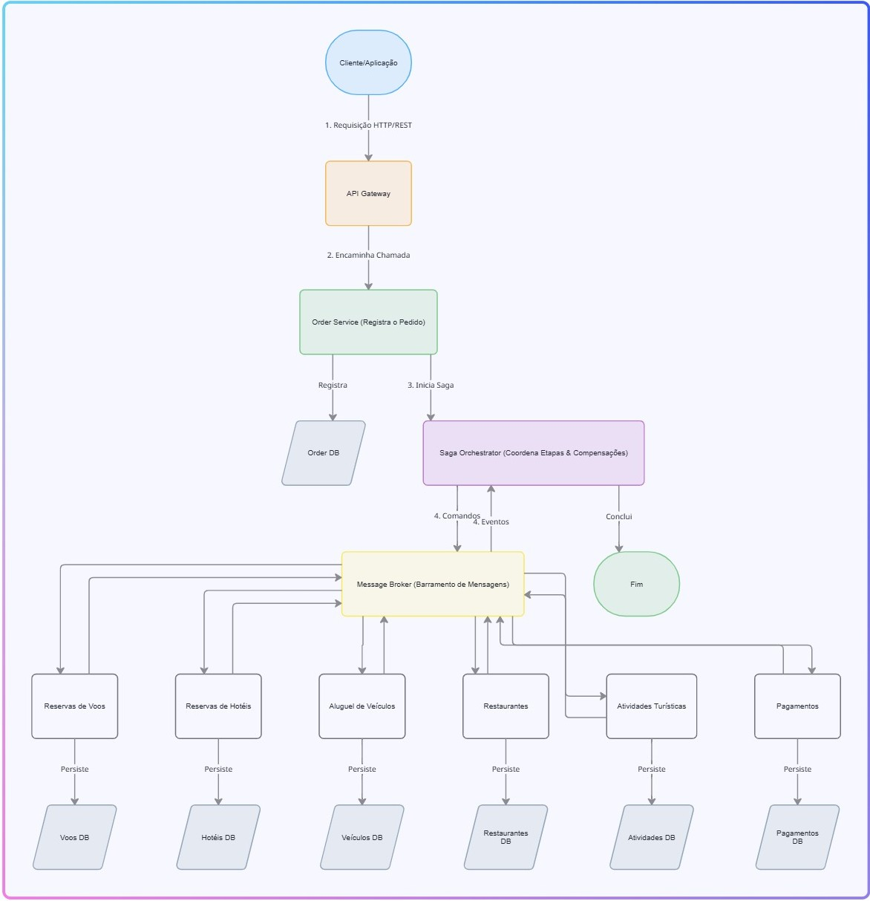
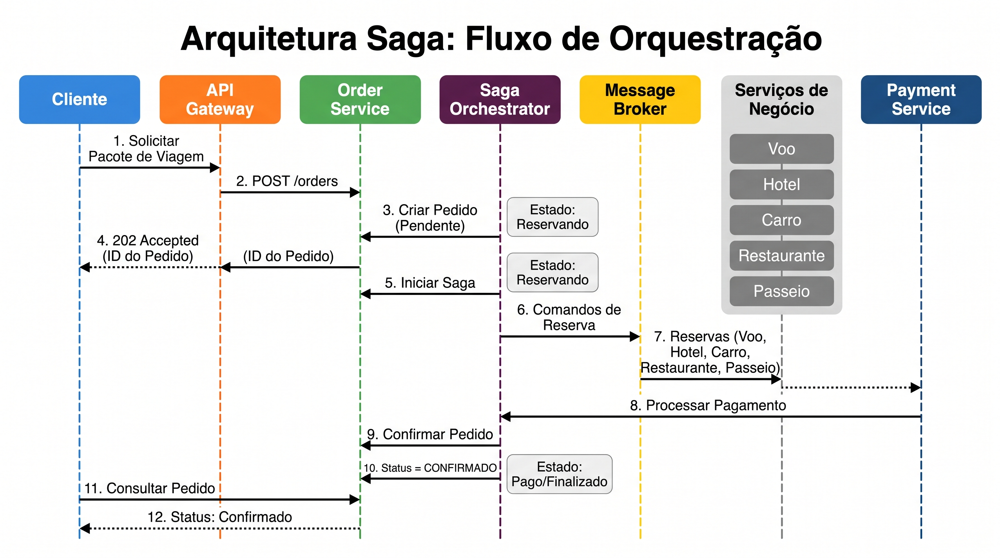
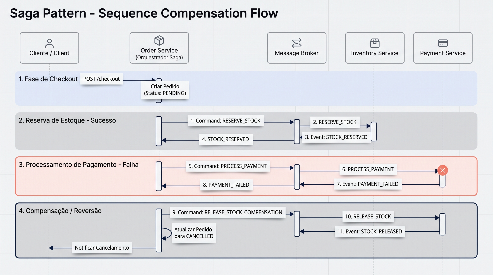

# TravelFlow: Arquitetura Saga (E-Commerce)

## 1. Visão Geral

O TravelFlow é uma plataforma de e-commerce que possui uma proposta de arquitetura distribuída,  baseada em microsserviços, para uma plataforma de viagens que comercializa pacotes integrados contendo passagem aérea, hospedagem, aluguel de carro, reserva em restaurante e passeios turísticos.
Este repositório apresenta a modelagem arquitetural do **padrão Saga com orquestração**, utilizado para garantir a consistência eventual e coordenar transações distribuídas entre microsserviços desacoplados e com bancos de dados independentes, *Database per Service*.

## 2. Objetivo

Demonstrar a coordenação de uma transação distribuída de compra envolvendo múltiplos domínios e bancos de dados, cobrindo tanto o fluxo de sucesso o *happy path*, quanto os cenários de falha e execução de transações compensatórias.

## 3. Arquitetura Proposta

A solução adota **Saga por Orquestração**, onde um componente orquestrador integrado ao `Order Service` controla a sequência das operações, gerencia a tabela de estado da transação e dispara as ações de compensação em caso de erro.

Os principais componentes são:

- **API Gateway**: Porta de entrada e roteamento das requisições;
- **Order Service (Orquestrador Saga)**: Registra o pedido e coordena o ciclo de vida da Saga;
- **Inventory Service**: Gerencia o estoque de produtos e realiza reservas temporárias;
- **Payment Service**: Processa cobranças e pagamentos com gateways financeiros externos;
- **Message Broker / Barramento de Mensagens**: Canal assíncrono para eventos e comandos de compensação.

## 4. Fluxo de Negócio

1. O cliente inicia a compra via checkout.
2. O **Order Service** registra o pedido com status `PENDING` e inicia a Saga.
3. O orquestrador solicita a reserva temporária de itens ao **Inventory Service**.
4. Após a confirmação da reserva, o orquestrador solicita o processamento da cobrança ao **Payment Service**.
5. **Sucesso**: Se a cobrança for aprovada, o pedido é atualizado para `APPROVED` e a Saga é concluída.
6. **Falha e Compensação**: Caso o pagamento seja recusado, o orquestrador dispara as compensações necessárias liberação do estoque no **Inventory Service** e cancelamento do pedido no **Order Service** para `CANCELLED`.

## 5. Estratégia de Falhas e Resiliência

A arquitetura trata ativamente falhas de rede, mensagens duplicadas, timeouts e indisponibilidade de serviços externos através de:

- **Idempotência**: Garantia de que reentradas e mensagens duplicadas não causem efeitos colaterais nos serviços.
- **Tabela de Estado (Saga State Machine)**: Acompanhamento rigoroso de timeouts e etapas do fluxo.
- **Mecanismos de Resiliência**: Retries com backoff exponencial, Circuit Breaker e tratamento via Dead-Letter Queue (DLQ) para reconciliação manual de compensações que falharem.

### 6. Diagramas

Os diagramas de arquitetura do projeto estão localizados no diretório `diagrams/`:

#### Visão Geral da Arquitetura

#### Fluxo de Sucesso

#### Fluxo de Compensação

## 7. Documentação Complementar

Aprofundamento técnico e especificações da arquitetura disponíveis em `/docs`:

- [`docs/decisoes-arquiteturais.md`](docs/decisoes-arquiteturais.md): Decisões técnicas, justificativa do padrão Saga, resiliência, Circuit Breakers e DLQ.
- [`docs/contratos-de-mensagens.md`](docs/contratos-de-mensagens.md): Estrutura e schemas JSON das mensagens trocadas entre os serviços.
- [`docs/matriz-de-falhas.md`](docs/matriz-de-falhas.md): Tabela de cenários de falha, idempotência e respectivas estratégias de compensação.

## 8. Escopo

Este repositório apresenta a blueprint arquitetural do padrão Saga. Os diagramas e documentos especificam o comportamento e os contratos de comunicação planejados para o sistema.

## 9. Limitações

Este repositório apresenta uma especificação arquitetural conceitual. Os contratos, políticas de repetição e integrações com fornecedores são propostas de projeto, não integrações implementadas ou testadas em produção.
