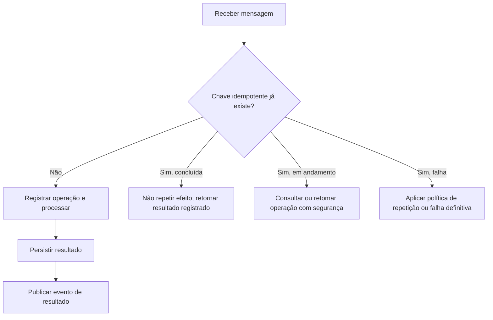

# Contratos de Mensagens, Idempotência e Controle de Estado — TravelFlow

Este documento especifica como os componentes conversam (comandos, eventos e envelope), como o sistema garante idempotência e como o orquestrador controla o estado da Saga.

Documentos relacionados: [`README.md`](../README.md) · [`decisoes-arquiteturais.md`](decisoes-arquiteturais.md) · [`matriz-de-falhas.md`](matriz-de-falhas.md)

---

## Contratos de comunicação

Os diagramas exemplificam o fluxo, enquanto uma blueprint define como os componentes conversam, estabelecendo contratos mínimos de comandos e eventos.

### Comandos e eventos

Um comando solicita que um serviço execute uma ação. Um evento informa que algo aconteceu.

| Tipo | Nome | Responsável |
|---|---|---|
| Comando | `StartTravelSaga` | Order Service → Orquestrador |
| Comando | `ReserveFlight` | Orquestrador → Flight Service |
| Evento | `FlightReserved` | Flight Service → Orquestrador |
| Comando | `ReserveHotel` | Orquestrador → Hotel Service |
| Evento | `HotelReserved` | Hotel Service → Orquestrador |
| Comando | `ReserveCar` | Orquestrador → Car Rental Service |
| Evento | `CarReserved` | Car Rental Service → Orquestrador |
| Comando | `ReserveRestaurant` | Orquestrador → Restaurant Service |
| Evento | `RestaurantReserved` | Restaurant Service → Orquestrador |
| Comando | `ReserveTour` | Orquestrador → Tour Service |
| Evento | `TourReserved` | Tour Service → Orquestrador |
| Comando | `CapturePayment` | Orquestrador → Payment Service |
| Evento | `PaymentCaptured` | Payment Service → Orquestrador |
| Evento | `PaymentDeclined` | Payment Service → Orquestrador |
| Comandos | `CancelTour`, `CancelRestaurant`, `ReleaseCar`, `CancelHotel`, `CancelFlight` | Orquestrador → serviços de reserva |
| Eventos | `TourCancelled`, `RestaurantCancelled`, `CarReleased`, `HotelCancelled`, `FlightCancelled` | Serviços de reserva → Orquestrador |

Também devem existir eventos de falha operacional, como `ReservationFailed`, `PaymentProcessingFailed` e `CompensationFailed`, com códigos que permitam distinguir erros permanentes de erros transitórios.

### Envelope padrão das mensagens

Todas as mensagens devem ter um envelope comum. Este é um exemplo ilustrativo em JSON:

```json
{
  "messageId": "msg-8f24c1",
  "messageType": "ReserveHotel",
  "schemaVersion": 1,
  "sagaId": "saga-73a91d",
  "orderId": "order-2026-1042",
  "correlationId": "saga-73a91d",
  "causationId": "msg-previous-001",
  "idempotencyKey": "saga-73a91d:reserve-hotel",
  "occurredAt": "2026-10-12T10:30:00Z",
  "payload": {
    "hotelId": "hotel-58",
    "checkIn": "2026-11-10",
    "checkOut": "2026-11-15",
    "guests": 2
  }
}
```

Os identificadores são fictícios, usados apenas para demonstrar a estrutura.

- `messageId`: identifica a mensagem individual.
- `sagaId`: identifica a execução da Saga.
- `orderId`: identifica a compra.
- `correlationId`: permite relacionar mensagens pertencentes à mesma execução.
- `causationId`: identifica a mensagem que originou aquela mensagem.
- `idempotencyKey`: identifica a operação de negócio para impedir duplicações.
- `schemaVersion`: permite evoluir os contratos de forma controlada.
- `occurredAt`: registra o instante do evento.
- `payload`: contém os dados específicos da operação.

O contrato deve evitar dados pessoais desnecessários. Dados de cartão, por exemplo, não devem circular livremente pelo barramento. O Payment Service deve trabalhar com tokens de pagamento ou referências seguras do provedor.

### Exemplo de evento de pagamento recusado

```json
{
  "messageId": "msg-payment-009",
  "messageType": "PaymentDeclined",
  "schemaVersion": 1,
  "sagaId": "saga-73a91d",
  "orderId": "order-2026-1042",
  "correlationId": "saga-73a91d",
  "causationId": "msg-capture-payment-008",
  "idempotencyKey": "saga-73a91d:capture-payment",
  "occurredAt": "2026-10-12T10:35:00Z",
  "payload": {
    "paymentReference": "pay-923",
    "reasonCode": "PAYMENT_DECLINED",
    "captured": false,
    "retryable": false
  }
}
```

O campo `retryable` é ilustrativo: a classificação real deve seguir o contrato do gateway e a natureza do erro. Uma recusa por saldo insuficiente, por exemplo, não deve ser tratada como timeout de rede.

---

### Mensagens duplicadas são um problema?

Imagine que o Flight Service conclua a reserva e publique `FlightReserved`. O broker entrega o evento ao orquestrador, mas o reconhecimento da mensagem não é registrado a tempo.

A mensagem pode ser entregue novamente. Se o orquestrador executar a etapa como se fosse inédita, poderá duplicar registros, avançar duas vezes o fluxo ou solicitar novamente uma operação financeira.

A solução é implementar consumidores idempotentes: receber a mesma mensagem várias vezes deve produzir, no máximo, um único efeito de negócio correspondente.

### Estratégia de idempotência

Cada serviço deve manter um registro persistente das operações processadas. Uma tabela conceitual pode ser:

| Campo | Finalidade |
|---|---|
| `message_id` | Identificar a mensagem recebida |
| `idempotency_key` | Identificar a operação lógica |
| `saga_id` | Vincular a operação à Saga |
| `operation_type` | Reserva, cancelamento, captura ou estorno |
| `status` | Em andamento, concluída ou falha |
| `result_reference` | Identificar a reserva ou operação financeira |
| `created_at` | Registrar o início |
| `updated_at` | Registrar a última alteração |

Uma restrição de unicidade sobre a chave idempotente, adequada ao escopo da operação, impede que dois processamentos concorrentes criem a mesma operação lógica.

O processamento deve seguir este raciocínio:



A consulta e o registro precisam ser protegidos contra concorrência. Não basta verificar se uma chave existe e depois inseri-la, pois duas mensagens podem chegar simultaneamente.

Além disso, a deduplicação interna não é suficiente quando o efeito ocorre em um fornecedor externo. O serviço precisa usar a mesma chave idempotente no provedor, quando houver suporte, ou consultar e reconciliar a operação antes de repeti-la.

### Como o orquestrador controla a Saga?

O orquestrador mantém o estado persistente da execução e registra cada transição antes de emitir novos comandos.

Uma tabela `saga_instance` pode conter:

| Campo | Exemplo | Finalidade |
|---|---|---|
| `saga_id` | `saga-73a91d` | Identificador único |
| `order_id` | `order-2026-1042` | Pedido associado |
| `state` | `RESERVING` | Estado global |
| `current_step` | `RESERVE_HOTEL` | Etapa atual |
| `version` | `4` | Controle de concorrência otimista |
| `created_at` | Data/hora | Início da execução |
| `updated_at` | Data/hora | Última atualização |
| `next_retry_at` | Data/hora ou nulo | Próxima tentativa |
| `last_error_code` | `SUPPLIER_TIMEOUT` | Último erro relevante |

Uma tabela `saga_step` complementa esse registro com o histórico de cada operação, sua chave idempotente, seu resultado, a referência do fornecedor e o estado da compensação.

> A matriz de decisão para erros e timeouts e o cuidado especial com o pagamento estão em [`matriz-de-falhas.md`](matriz-de-falhas.md).