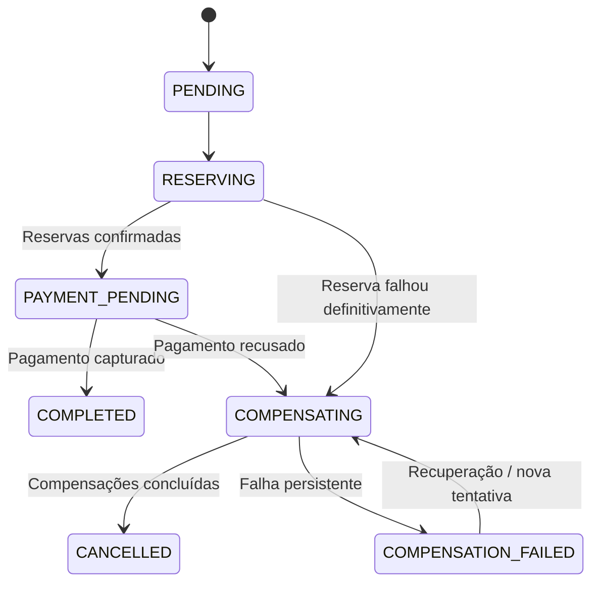

# Decisões Arquiteturais — TravelFlow

Este documento reúne a máquina de estados da Saga, os riscos mitigados e as estratégias de resiliência (Retry, Circuit Breaker, Dead-Letter Queue e Transactional Outbox), além de segurança e observabilidade.

Documentos relacionados: [`README.md`](../README.md) · [`contratos-de-mensagens.md`](contratos-de-mensagens.md) · [`matriz-de-falhas.md`](matriz-de-falhas.md)

---

## Definir a máquina de estados da Saga

Antes dos diagramas de sequência, vale definir os estados que representam o ciclo de vida da compra. Isso evita que o sistema fique com estados contraditórios.

### Estados principais

- **`PENDING` — Pedido criado:** A compra foi registrada, mas ainda não foi confirmada.
- **`RESERVING` — Reservas em andamento:** Os serviços estão sendo reservados e confirmados.
- **`PAYMENT_PENDING` — Pagamento em processamento:** As reservas necessárias foram confirmadas; o pagamento aguarda conclusão.
- **`COMPLETED` — Saga concluída:** As reservas foram confirmadas e o pagamento foi capturado.
- **`COMPENSATING` — Compensação em andamento:** O sistema está cancelando reservas ou revertendo efeitos financeiros.
- **`COMPENSATION_FAILED` — Compensação exige intervenção:** Uma ou mais compensações não foram concluídas após as tentativas permitidas. O processo precisa de recuperação controlada.
- **`CANCELLED` — Pedido cancelado:** As operações compensáveis foram resolvidas e o pedido foi encerrado como cancelado.

`COMPENSATION_FAILED` não significa que o pedido foi cancelado com sucesso. Esse estado indica que ainda existe trabalho pendente, por exemplo, cancelar uma reserva no fornecedor ou confirmar um estorno.

Também é útil separar o estado comercial do pedido do estado técnico da Saga. O pedido pode estar marcado como cancelamento solicitado enquanto a Saga ainda tenta concluir as compensações.

### Transições de estado

O sistema também deve considerar uma falha ou timeout depois do envio de um comando, mas antes de receber sua resposta. Esse cenário não significa necessariamente que a operação falhou. A seção de idempotência e timeouts (em [`contratos-de-mensagens.md`](contratos-de-mensagens.md) e [`matriz-de-falhas.md`](matriz-de-falhas.md)) explicará como resolver essa ambiguidade.

---

## Planejando a resiliência:

### Retry — repetição controlada

O Retry permite repetir uma operação quando existe evidência de que a falha pode ser temporária.

Uma política inicial para a blueprint pode ser:

- Até três tentativas automáticas para erros transitórios, além da tentativa inicial.
- Backoff exponencial, aumentando o intervalo entre tentativas.
- Jitter aleatório para evitar que muitos serviços repitam ao mesmo tempo.
- Respeito aos limites de taxa e ao Retry-After informado pelo fornecedor.
- Proibição de repetir operações não idempotentes sem uma estratégia segura de reconciliação.

Os números são parâmetros iniciais propostos para o projeto, não valores universais.

### Circuit Breaker — proteção contra falhas persistentes

O Circuit Breaker interrompe temporariamente as chamadas a um fornecedor quando há um padrão de falhas que indica indisponibilidade.

Ele costuma ter três estados:

- **Closed:** chamadas permitidas normalmente.
- **Open:** chamadas bloqueadas temporariamente.
- **Half-open:** poucas chamadas de teste são liberadas para verificar a recuperação.

O mecanismo evita sobrecarregar um fornecedor indisponível e reduz o consumo desnecessário de recursos internos.

É importante não confundir Circuit Breaker com Retry: o primeiro limita chamadas durante falhas persistentes; o segundo repete uma operação de forma controlada.

### Dead-Letter Queue — fila de mensagens problemáticas

A DLQ armazena mensagens que não puderam ser processadas depois das políticas de repetição definidas.

Ela deve registrar ou permitir consultar:

- Mensagem original.
- Número de tentativas.
- Último erro.
- Horário da falha.
- `sagaId`, `orderId` e `messageId`.
- Motivo do encaminhamento à DLQ.

A DLQ não deve funcionar como um depósito de mensagens esquecidas. É necessário monitoramento, alerta, procedimento de análise e reprocessamento controlado.

Antes de reprocessar uma mensagem, a equipe deve verificar se o efeito já ocorreu no fornecedor. O reprocessamento deve preservar a chave idempotente original.

### Transactional Outbox

Considere que o Hotel Service conclua uma reserva e grave o resultado no banco, mas falhe antes de publicar `HotelReserved`.

Sem uma estratégia de publicação confiável, o orquestrador pode ficar esperando um evento que nunca chegará.

O padrão Transactional Outbox resolve essa lacuna:

1. Na mesma transação local, o serviço grava a reserva e uma mensagem pendente na tabela de outbox.
2. Um publicador lê os registros pendentes e envia as mensagens ao broker.
3. Após a confirmação de publicação, o registro é marcado como enviado.
4. Se o publicador falhar, poderá tentar novamente.
5. Como uma publicação repetida é possível, o consumidor continua usando idempotência.

Esse padrão não cria uma transação ACID distribuída. Ele garante que a alteração de negócio e a intenção de publicar a mensagem sejam persistidas juntas no banco local.

> A matriz de resiliência está em [`matriz-de-falhas.md`](matriz-de-falhas.md).

### Segurança e observabilidade

Para uma arquitetura de viagens que manipula dados de clientes e pagamentos, também precisamos estabelecer:

- Autenticação e autorização entre serviços.
- Criptografia em trânsito e proteção dos dados persistidos.
- Segredos e credenciais fora do código-fonte.
- Logs estruturados, sem dados de cartão ou informações pessoais desnecessárias.
- Métricas de duração das Sagas, taxa de falha e compensações pendentes.
- Rastreamento distribuído com `correlationId` e `sagaId`.
- Alertas para DLQ, timeouts persistentes e falhas de compensação.
- Políticas de retenção dos registros de auditoria.

Essas medidas complementam a consistência eventual: o sistema precisa não apenas continuar funcionando, mas também permitir que a equipe identifique e corrija operações incompletas.